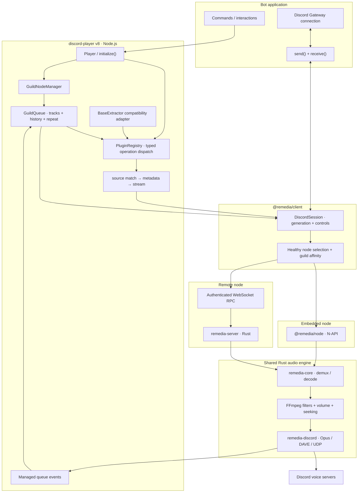

v8 is built around **clear ownership**. Discord Player decides _which_ Track should play, plugins resolve _where_ its media lives, and Remedia handles _how_ bytes become audio. This separation lets the same queue API use an embedded engine or a remote audio server.

## The system at a glance

<ArchitectureDiagram />

The detailed diagram below expands the overview into individual components. Both diagrams are embedded SVGs and work offline in the static docs. Expand **View Mermaid source** below the detailed diagram to copy it into your architecture tooling and modify it.

## 1. The application boundary

The Discord library supplies commands, guild/channel IDs, and raw Gateway events. `send()` returns voice-state requests to the right shard; `receive()` forwards relevant dispatches. This is why v8 can work with different Discord libraries without shipping separate adapters.

## 2. The managed queue boundary

`Player` owns `GuildNodeManager`, and each `GuildQueue` owns upcoming Tracks, the currently active managed operation, history, repeat/shuffle policy, and serialized transitions. The queue selects the next Track and reconciles native lifecycle events, including out-of-order or duplicated notifications.

The queue does **not** decode files or send Discord UDP packets. `queue.node.play()` is intentionally raw Remedia playback and must not be mistaken for the managed scheduling API.

## 3. The plugin boundary

`PluginRegistry` dispatches named operations: `search.query.match`, `search.query.resolve`, `track.stream`, related-track lookup, bridging, and local encoded-stream transformation.

The `BaseExtractor` compatibility adapter translates its supported methods into those same operations. There is no competing legacy dispatcher inside the framework. Stream resolution stays in the application process in the current v8 design; plugins are not automatically shipped to remote audio nodes.

## 4. The Remedia client boundary

`@remedia/client` maintains guild-to-node affinity, session creation, connected/disconnected state, and playback generations. The selected node is either embedded or remote. Both paths speak to the same Rust playback engine; remote mode adds an authenticated RPC connection and a separate process.

## 5. The native engine and voice boundary

`remedia-core` opens a source with FFmpeg, decodes/resamples audio, applies filters/volume, and tracks source position. `remedia-discord` handles codec output and Discord voice transport, including the security protocol and UDP delivery. Playback lifecycle events return to the client and then to the owning queue.

## Read the rest in order

<Cards>
  <Card
    title="Track lifecycle"
    href="/docs/architecture/lifecycle"
    description="The sequence from a query to terminal playback and the next Track."
  />
  <Card
    title="Design decisions"
    href="/docs/architecture/design-decisions"
    description="Why the boundaries exist, including trade-offs and known limits."
  />
  <Card title="Plugins" href="/docs/plugins" description="How source integrations plug into the dispatch system." />
</Cards>

<NextStep href="/docs/architecture/lifecycle" label="Follow the playback lifecycle" />
