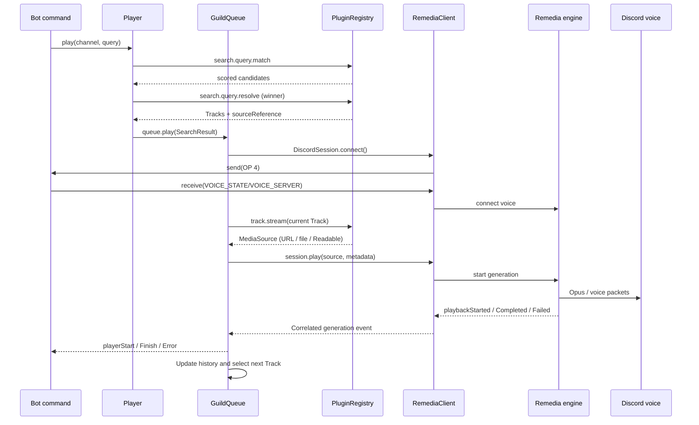

Consider a call to:

```ts
await player.play({ guildId, channelId }, 'https://media.example.com/song.mp3');
```

The call crosses several ownership boundaries. Each has a different failure and cancellation policy.

## Request and execution path



## Why generations matter

A queue may receive an event before the original `play()` request has finished. It cannot rely on event arrival order alone. v8 associates each managed operation with a queue token, an operation ID, the exact Remedia session, and a playback generation. This prevents a stale terminal event from completing the wrong Track after a skip, replay, or reconnect.

## When a Track ends

Natural completion records history when appropriate and advances according to the repeat mode. A skip is a separate terminal transition. A stop leaves upcoming Tracks intact. A playback failure returns the Track to the head of the upcoming queue for deliberate retry.

Application listeners such as `player.events.on('playerFinish')` are notifications. They do not need to issue `queue.playNext()` for normal progression.

## Why a local stream is special

A Node.js Readable can supply encoded bytes to an embedded native engine. A remote engine cannot consume that same in-process object. If your application uses remote nodes, a source plugin must resolve to an URL or path accessible from that remote machine.

<NextStep href="/docs/architecture/design-decisions" label="Understand the design trade-offs" />

## Overlapping generations

Automatic crossfading reserves a distinct upcoming occurrence on `prepareRequested`. Its source uses the normal plugin pipeline. Native incoming `playbackStarted` commits the reservation and emits `playerStart`; outgoing `playbackCompleted` finalizes history and emits `playerFinish` without starting playback again or clearing the incoming Track. The queue retains outgoing generations independently of the current operation. See the [crossfade guide](/docs/guides/crossfade).
