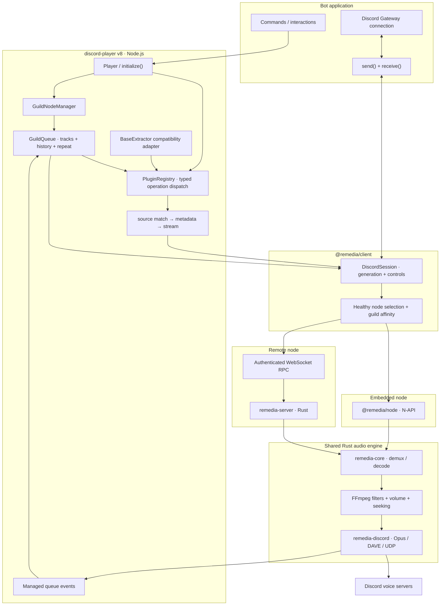

This section is for contributors and for developers who want to understand what happens underneath. You do not need it to build a bot.

Discord Player decides which track plays, plugins decide where its audio lives, and Remedia turns that audio into sound on Discord. The split lets one queue API work with an embedded engine or a remote audio server.

## Overview

<ArchitectureDiagram />

## Components in detail

## The five boundaries

### 1. Application

Your bot supplies commands, guild and channel IDs, and raw gateway packets. `send()` routes voice requests to the right shard. `receive()` takes every packet, and Remedia uses the voice-related ones. Because the contract is plain packets, one Player works with any Discord library.

### 2. Managed queue

`Player` owns a `GuildNodeManager`. Each `GuildQueue` owns upcoming tracks, the active playback operation, history, repeat and shuffle, and serialized transitions. It picks the next track and reconciles Remedia events, including duplicated or out-of-order ones.

The queue never decodes audio or sends UDP packets. `queue.node.play()` is raw Remedia playback. It is not queue scheduling.

### 3. Plugins

`PluginRegistry` dispatches named operations such as `search.query.match`, `search.query.resolve`, `track.stream`, `track.related`, `track.bridge`, and `stream.transform`.

The `BaseExtractor` adapter turns legacy methods into the same operations, so there is one dispatcher. Source resolution runs in your bot process. Plugins are not copied to remote audio nodes.

### 4. Remedia client

`@remedia/client` keeps guild-to-node affinity, creates sessions, and tracks connection state and playback generations. The selected node is embedded or remote. Both run the same Rust engine, and remote adds an authenticated connection and a separate process.

### 5. Engine and voice

`remedia-core` opens the source with FFmpeg, decodes and resamples it, applies filters and volume, and tracks the source position. `remedia-discord` encodes Opus and delivers it over Discord's encrypted voice transport. Playback events return through the client to the owning queue.

## Read next

<Cards>
  <Card
    title="Playback lifecycle"
    href="/docs/v8/architecture/lifecycle"
    description="From a query to the next track."
  />
  <Card
    title="Design decisions"
    href="/docs/v8/architecture/design-decisions"
    description="Why the boundaries exist, and the limits."
  />
  <Card title="Source plugins" href="/docs/v8/plugins" description="How plugins join the dispatch system." />
</Cards>

<NextStep href="/docs/v8/architecture/lifecycle" label="Playback lifecycle" />
