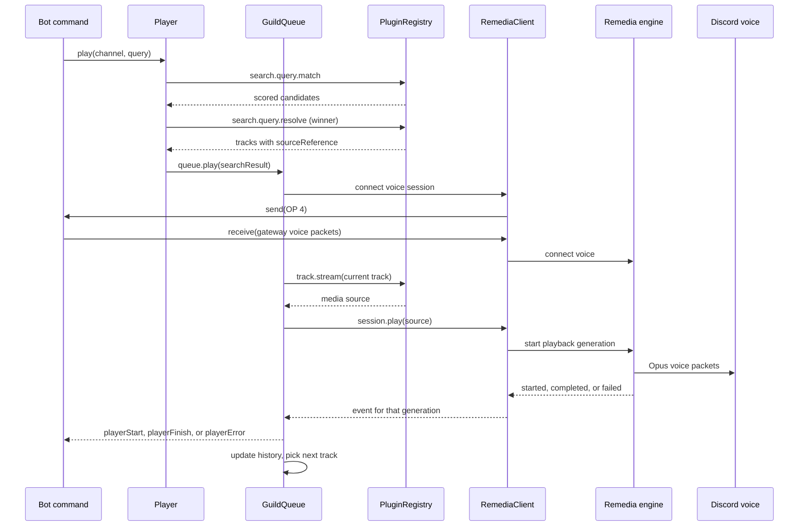

Consider this call:

```ts
await player.play({ guildId, channelId }, 'https://media.example.com/song.mp3');
```

It crosses several ownership boundaries, and each has its own failure and cancellation rules.

## Request path



## Generations

An event can reach the queue before the original `play()` call returns, so the queue cannot trust arrival order. Each managed operation carries a queue token, an operation ID, the exact session, and a Remedia playback generation. A stale event from a skipped, replayed, or reconnected track is therefore ignored.

## How a track ends

| Outcome     | What the queue does                                                  |
| ----------- | -------------------------------------------------------------------- |
| Natural end | Records history when repeat allows it and advances by repeat mode    |
| Skip        | A separate transition that records history and starts the next track |
| Stop        | Keeps upcoming tracks                                                |
| Failure     | Puts the track back at the front of the queue for you to retry       |

`playerFinish` and the other events are notifications. They do not need `queue.playNext()` for ordinary progression.

## Local streams

A Node.js `Readable` can feed an embedded engine because both live in one process. A remote engine cannot read it. With remote nodes, a plugin must return a URL or path the remote machine can open.

## Overlapping tracks with crossfade

With crossfade, Remedia asks for the next track with `prepareRequested`. The queue reserves a separate upcoming entry and resolves its source through the normal plugin pipeline. The incoming `playbackStarted` commits the reservation and fires `playerStart`. The outgoing `playbackCompleted` records history and fires `playerFinish`, without restarting playback or clearing the incoming track. The queue tracks outgoing generations separately from the current one. See [crossfade](/docs/v8/guides/crossfade).

<NextStep href="/docs/v8/architecture/design-decisions" label="Design decisions" />
