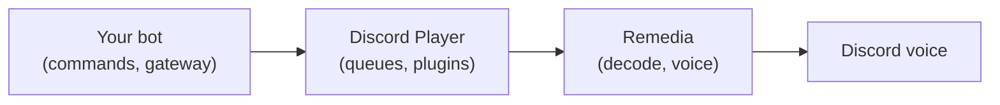

<Callout type="warn" title="Development preview">
  v8 is in development and its API can still change. The stable release is documented in [v7](/docs/v7).
</Callout>

Discord Player manages queues, playback controls, and events for Discord music bots. [Remedia](https://github.com/twlite/remedia) decodes audio and sends it over Discord voice, either inside your bot process or on a separate server.

<Cards>
  <Card
    title="Get started"
    href="/docs/v8/getting-started"
    description="Generate a bot with one command and play your first track."
  />
  <Card title="Guides" href="/docs/v8/guides" description="Queues, controls, events, voice, filters, and crossfade." />
  <Card title="Migrate from v7" href="/docs/v8/migration" description="Update an existing music bot." />
  <Card title="API reference" href="/docs/v8/reference" description="Methods, options, and event arguments." />
</Cards>

## What you need

| Requirement   | Details                                                                                                |
| ------------- | ------------------------------------------------------------------------------------------------------ |
| Runtime       | Node.js 22.18 or newer, ESM                                                                            |
| Discord bot   | Any gateway library. The tutorial uses discord.js                                                      |
| Source plugin | Turns a query into tracks and audio. The generated bot includes one                                    |
| FFmpeg 9      | Shared libraries on the machine that runs the audio engine. See [FFmpeg](/docs/v8/installation/ffmpeg) |

## How the pieces fit

Your bot owns the Discord connection and commands. Discord Player owns tracks, queues, and source plugins. Remedia owns decoding and voice transport. The [architecture](/docs/v8/architecture) section covers the details.

## Where to go next

| I want to                    | Read                                                  |
| ---------------------------- | ----------------------------------------------------- |
| Build my first bot           | [Getting started](/docs/v8/getting-started)           |
| Add it to an existing bot    | [Manual setup](/docs/v8/getting-started/manual-setup) |
| Add a music provider         | [Source plugins](/docs/v8/plugins)                    |
| Run audio on another machine | [Remote playback](/docs/v8/remedia/remote)            |
| Upgrade a v7 bot             | [Migration guide](/docs/v8/migration)                 |
| Look up a method or event    | [API reference](/docs/v8/reference)                   |

<NextStep href="/docs/v8/getting-started" label="Build your first music bot" />
