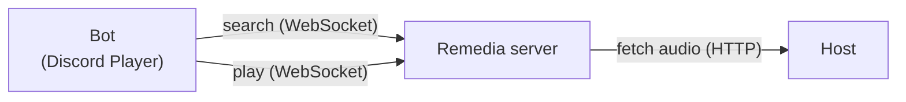

A source host runs plugins away from your bot and away from the audio node. The bot discovers and searches through Remedia forwarding, and the Remedia node pulls the audio directly from it.



Use a source host when credentials must stay off the bot, or when the audio node needs to reach media that only the host can open. A normal bot registers plugins directly on `player.plugins` and does not need this.

## Requirements

- `@remedia/client`, `@remedia/plugin-host`, and the Remedia server must all be `0.1.0`.
- The bot needs no native audio binding for remote playback.
- Install `@discord-player/plugin-host` and `@remedia/plugin-host` on the host machine.

The example below runs everything on one machine. The ports are:

| Service        | Address                    |
| -------------- | -------------------------- |
| Source host    | `http://127.0.0.1:8080`    |
| Remedia server | `remedia://127.0.0.1:8787` |

## 1. Run the source host

This host serves one local audio file through an extractor. Replace `MyExtractor` with your provider.

```ts title="source-host.ts"
import { createReadStream } from 'node:fs';
import { createServer } from 'node:http';
import { BaseExtractor, Track, createSourcePluginHost } from '@discord-player/plugin-host';
import { createNodeMiddleware } from '@remedia/plugin-host/node';

class MyExtractor extends BaseExtractor {
  static identifier = 'example.audio';

  async validate() {
    return true;
  }

  async handle(query: string) {
    return this.createResponse(null, [
      new Track(this.context.player, {
        title: query,
        url: 'https://example.com/audio',
        duration: '0:10',
      }),
    ]);
  }

  async stream() {
    return createReadStream(process.env.AUDIO_FILE!);
  }
}

const host = createSourcePluginHost({
  name: 'My Sources',
  hostId: 'sources-1',
  publicUrl: 'http://127.0.0.1:8080',
  token: process.env.SOURCE_TOKEN!,
});

await host.extractors.register(MyExtractor);

const middleware = createNodeMiddleware(host);

createServer((req, res) => {
  void middleware(req, res, () => res.writeHead(404).end());
}).listen(8080, '127.0.0.1');
```

Set these environment variables:

| Variable       | Value                                    |
| -------------- | ---------------------------------------- |
| `AUDIO_FILE`   | Absolute path to an MP3 or Ogg/Opus file |
| `SOURCE_TOKEN` | A secret of at least 16 characters       |

The host keeps provider credentials. Do not put credentials in track metadata.

## 2. Configure the audio node

Generate a starter configuration for the Remedia server:

```bash
remedia-server --generate-config-file
```

Add a `pluginHosts` entry to `remedia.config.json`:

```json
{
  "pluginHosts": [
    {
      "id": "sources-1",
      "endpoint": "http://127.0.0.1:8080",
      "auth": { "type": "bearer", "token": "env('SOURCE_TOKEN')" },
      "allowInsecureHttp": true,
      "allowPrivateNetwork": true,
      "operations": [
        { "pluginId": "discord-player.source", "operation": "source.search" },
        { "pluginId": "discord-player.source", "operation": "source.related" },
        { "pluginId": "discord-player.source", "operation": "metadata.execute" },
        {
          "pluginId": "discord-player.source",
          "operation": "source.stream",
          "replaySafe": true
        }
      ]
    }
  ]
}
```

| Field                                      | Meaning                                                                                                           |
| ------------------------------------------ | ----------------------------------------------------------------------------------------------------------------- |
| `id`                                       | Must match the `hostId` of the source host                                                                        |
| `endpoint`                                 | The host's origin: scheme, host, and port only                                                                    |
| `allowInsecureHttp`, `allowPrivateNetwork` | Needed only because this example uses plain HTTP on loopback. Remove them for a public HTTPS endpoint             |
| `replaySafe`                               | Allows Remedia to run the operation again for a fresh grant. Enable it only when opening the source twice is safe |

`SOURCE_TOKEN` must be available to the server's configuration, for example in the `.env` file passed with `--env-file`:

```bash
remedia-server serve --config ./remedia.config.json --env-file .env
```

Unavailable hosts and stale manifests are excluded from discovery. Unsupported servers remain usable with local plugins or explicit HTTP registration. Transport and authorization errors propagate; only empty or unhandled results try the next host. The server discovers the host and reports it in `pluginOperations.hosts`. For crossfade, also set `audio.crossfade.enabled` to `true` on the server.

## 3. Configure the bot

```ts title="bot.ts"
import { Player } from 'discord-player';
import { Client, Events, GatewayIntentBits } from 'discord.js';

const client = new Client({ intents: [GatewayIntentBits.Guilds, GatewayIntentBits.GuildVoiceStates] });

const player = new Player({
  nodes: [
    {
      id: 'audio-1',
      type: 'remote',
      url: 'remedia://127.0.0.1:8787',
      auth: { username: 'bot', password: process.env.REMEDIA_PASSWORD! },
    },
  ],

  send(guildId, payload) {
    const guild = client.guilds.cache.get(guildId);

    if (!guild) throw new Error(`Guild ${guildId} is not cached.`);

    return guild.shard.send(payload);
  },
});

client.on(Events.Raw, (packet) => player.receive(packet));

client.once(Events.ClientReady, async (ready) => {
  await player.initialize(ready.user.id);

  const result = await player.search('fixture', { requestedBy: ready.user.id });

  await player.play({ guildId: process.env.GUILD_ID!, channelId: process.env.CHANNEL_ID! }, result);
});

await client.login(process.env.DISCORD_TOKEN);
```

The bot configures only Remedia nodes. Source endpoints, host IDs and source credentials stay on the server. The Remedia username and password must match a server user authorized for plugin forwarding.

Allow `source.search` and `source.stream` for discovery and playback. Allow `source.related` for autoplay and `metadata.execute` for Track-based lyrics lookup when the source provider implements them. Local lifecycle hooks are never forwarded. Free-text lyrics discovery is not available because Remedia advertises host operations rather than individual provider IDs.

## Optional direct HTTP registration

Existing applications can register a host explicitly when the bot should contact it directly:

```ts
import { definePlugin } from 'discord-player';

await player.plugins.register(
  definePlugin({
    id: 'example.audio',
    remoteHost: {
      hostId: 'sources-1',
      url: 'https://sources.example.com',
      token: process.env.SOURCE_TOKEN,
    },
  })(),
);
```

This approach requires bot-side access and credentials. The audio node must also reach the host for playback. Automatic Remedia discovery requires no such registration.

## How routing works

| Topic                | Behavior                                                                                                                                         |
| -------------------- | ------------------------------------------------------------------------------------------------------------------------------------------------ |
| Search order         | Local plugins first, then explicit HTTP registrations, then eligible Remedia nodes and hosts in discovery order. The first non-empty result wins |
| Scores               | Not compared across hosts. Each host uses its own matching and priorities                                                                        |
| Restrict to one host | `search(query, { hostId })`                                                                                                                      |
| Select a provider    | `searchEngine: 'provider-id'`                                                                                                                    |
| Errors               | Authentication, identity, and transport errors fail the search. An empty result moves on to the next host                                        |
| Cancellation         | Cancelling a search, a timeout, or destroying the Player cancels forwarded work through Remedia                                                  |
| Sent to the host     | Portable search hints and the requester ID only. Functions, Discord objects, and credentials are never sent                                      |
| Discovery            | On-demand Remedia discovery uses server-cached manifests; no background polling is added                                                         |

## Playback and affinity

Tracks remember the host and node that created them (`sourceReference.hostId` and `sourceReference.nodeId`) in queues and history. `serialize()` keeps both identities and leaves out temporary state.

When a track plays, the Player checks that the assigned node lists that host. Then it sends Remedia an operation source instead of a URL:

```ts
{ hostId, pluginId: 'discord-player.source', operation: 'source.stream', input: { track } }
```

Remedia runs it and receives the encoded audio straight from the host. The bot never opens that stream.

- Playback pins new sessions to the originating node. Existing sessions and sticky guild assignments must agree; incompatible placement fails explicitly. Embedded nodes cannot play remotely discovered Tracks.
- Tracks from different nodes cannot share one queue session, even when host IDs match. Tracks from several hosts on the same node are supported. Crossfade uses the same placement checks. No guild migration is performed.
- Every play creates a new operation, so expired grants and track state are rebuilt. If a track's state expired, search again.
- If the host is down, preparing or playing tracks from it fails. Retry after it recovers.
- Node disconnects and recovery are handled by Remedia. Discord Player does not migrate guilds to another node or host.
- Never save grant URLs.

## Troubleshooting

| Symptom                             | Check                                                                                    |
| ----------------------------------- | ---------------------------------------------------------------------------------------- |
| `Source host ... is not configured` | For explicit HTTP registration, check the bot registration and host ID                   |
| `cannot access source host`         | The audio node's `pluginHosts` includes this host and the node is a remote node          |
| Search works, playback fails        | `endpoint` and `allowInsecureHttp` on the server, and that the server can reach the host |
| `401` from the host                 | `SOURCE_TOKEN` matches on the host and server (also the bot for direct HTTP)             |

<NextStep href="/docs/v8/remedia/remote" label="Remote Remedia nodes" />
